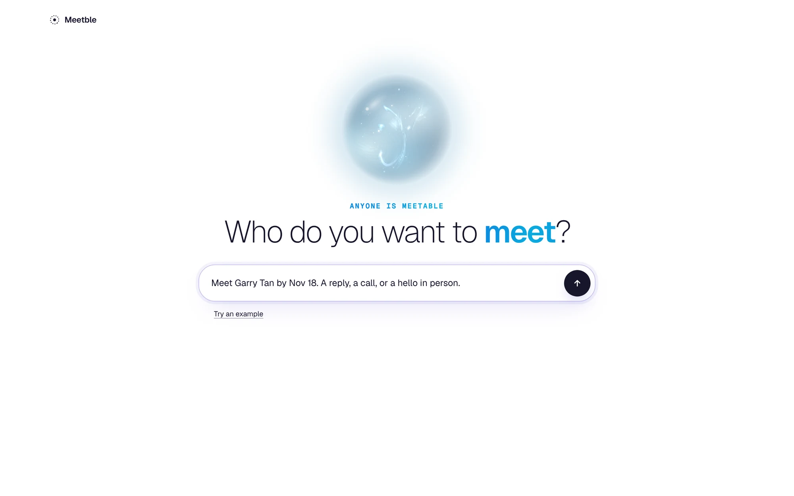
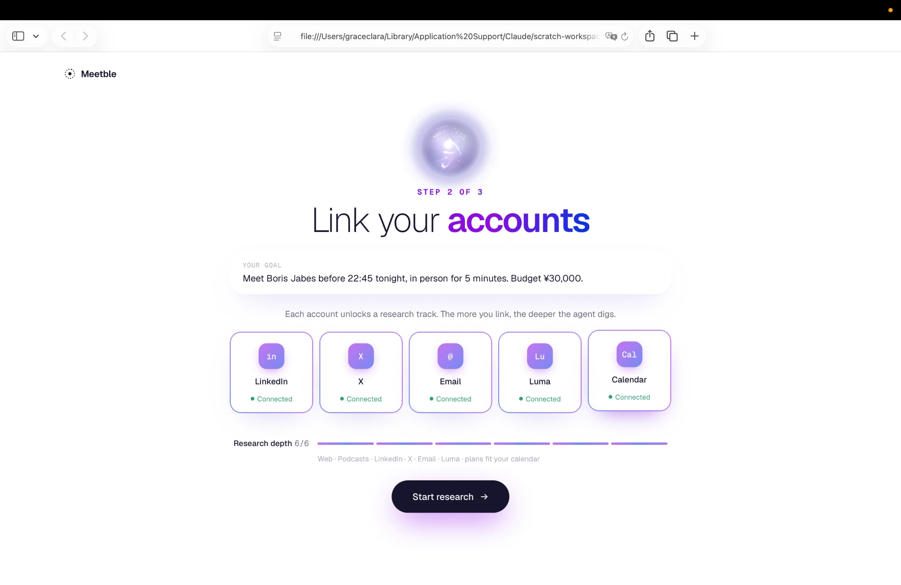
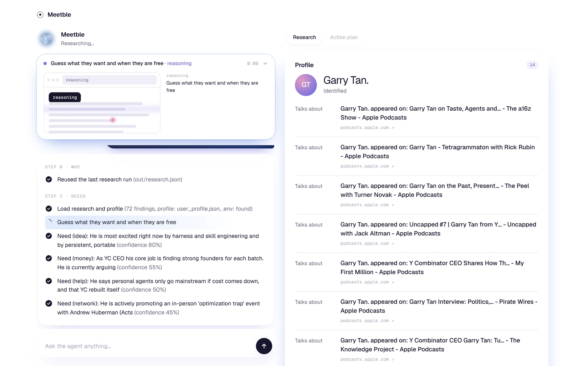
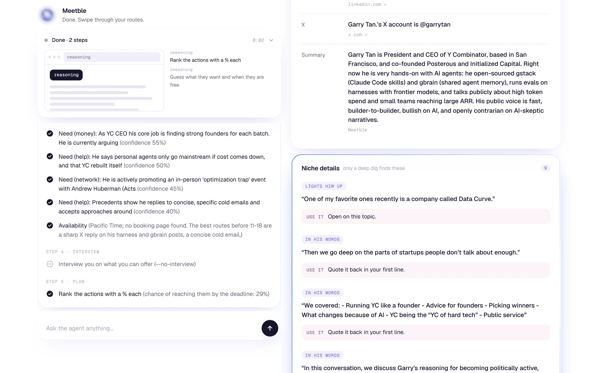
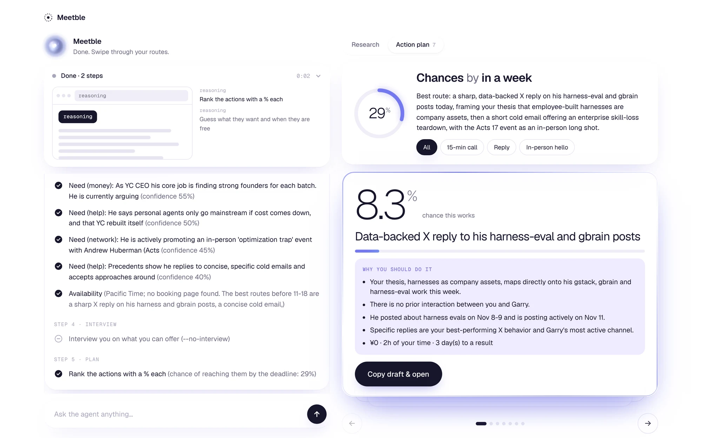

# Meetble

Hi people attending Y Combinator Startup School in Taiwan!!

Do you want to meet with Garry tan?\
We build AI agents that find the best way to reach out to people you want and do anything it takes to reach out to him.

**We are AI agents that find the best way to reach out to people, and do anything it takes to reach them.**\
**This agent may suggest you actually present at the event or present at a certain place, but this will definitely help you reach out and meet the person you want.**

## Screenshots

From a real run on the local server (`node server.mjs`), target Garry Tan, with "Reuse the last research run" on.

**1. Ask who you want to meet**\


**2. Link your accounts**\


**3. Watch the agent research**\


**4. Research board: profile, summary, and niche details in his own words**\


**5. Action plan: ranked routes, each with its % chance**\


## How it works

**Step 0: Define the person you want to meet, and by when.**

- Type a name, a deadline, and what "meet" means (a 15-min call, a reply, a hello in person).
- The deadline matters. Anything that can't pay off in time gets dropped.

**Step 1: Research what they want.**

1. Give your profile first.
2. Then it researches the person from different dimensions:
   - Web (interviews, essays, talks)
   - X: their posts and replies, and who they talk to most
   - LinkedIn: posts, comments, and mutual connections (through your own login)
   - Instagram, public captions only
   - Their work email, with a confidence score
   - Podcasts! Their own words, with links
   - People who already reached them, and how
3. Every search and finding goes into a log with its source.

**Step 2: What is he doing right now?**

- Mentions over the past 7 days
- A public Calendly or cal.com page, if there is one
- Events he's speaking at or going to (Luma guest lists, speaker pages)

**Step 3: Guess what they want.**

- Money? Network? A cool idea? A gift or a lunch? Help with something?
- Every guess comes with the evidence, and a reason it might be wrong.

**Step 4: The agent interviews you.**

- Up to 3 questions, each based on something it found. For example: "He talked about data infra for AI on a podcast. Do you have users or data there?"

**Step 5: The % and the actions, even if it's 1%.**

- Referral from your network, running into him at an event, his booking page, a cold email or DM, a gift to his office, paid consulting, posting about what he cares about and mentioning him...
- Each action shows its %, cost, time, and why. Drafts quote something he actually said.
- The AI doesn't make up the %. It gives a base rate and four reasons (relevance, timing, warmth, channel), and the code does the math.

**UI:** a chat, and every search shows up as a checklist line with an icon and a short result in parentheses.

## What's inside

- **Anthropic API** (Claude) runs the agent
- **Exa** for web, people, podcast and event search
- **xAI x_search** (Grok) for X
- **browser-use** in my own Chrome, only for Luma and LinkedIn. Everything else (X, email) comes out as a draft for me to send.

## Run it

You need these in `.env` (copy `.env.example`):

- `ANTHROPIC_API_KEY` (required)
- `XAI_API_KEY` (required)
- `EXA_API_KEY` (recommended; without it, it uses Exa's free public endpoint)
- `MODEL_API_KEY`, `HUNTER_API_KEY` (optional: Instagram and email)

On Windows PowerShell 5, one line at a time:

```powershell
cd C:\tmp
git clone https://github.com/yukeidaro/meetble.git
cd meetble
Copy-Item .env.example .env
notepad .env
node dist/cli.js "Boris Jabes" --deadline 2026-11-20 --x-handle borisjabes
python -m plan out\research.json --profile user_profile.json
```

The first command does the research (Steps 0–2) and writes `out/research.json`. The second one guesses what he wants, asks you questions, and ranks the actions (Steps 3–5). You need Node 18+ and Python 3.10+. For the video, `--answers "a|b|c"` scripts the Step 4 answers. The plan comes out as `out\plan.md`. There's nothing to `npm install` or `pip install`.

### Run it as an app (UI + real pipeline)

```powershell
node server.mjs
```

Then open http://localhost:8787. Type who and by when ("Meet Boris Jabes before 22:45 tonight, in person. Budget ¥30,000."), add a hint or X handle if you have one, and press Start research. The server runs both commands above on this computer and streams every checklist line into the UI, then shows the ranked actions as cards. "Copy draft & open" copies the draft and opens the link; you press send yourself. Tick "Reuse the last research run" to skip Steps 0–2 on a retake. If `dist\cli.js` is missing, run `npm install` and then `npm run build` once. Opening `ui/index.html` straight from disk (or adding `?demo=1`) plays the sample run instead.

For Luma and LinkedIn, also install browser-use (`pip install "browser-use[anthropic]"`), turn on remote debugging in Chrome at `chrome://inspect/#remote-debugging`, and stay logged in:

```powershell
python browser_tools.py login-check
python browser_tools.py luma-my-events
python browser_tools.py luma-check https://luma.com/compiled-poy7
python browser_tools.py linkedin-profile "Boris Jabes"
```

The research run starts with a sign-in check of Luma, LinkedIn, X and Instagram in your Chrome. If a site is signed out, it lists the login pages and waits: you sign in yourself (Meetble never types a password), then press Enter. Set `LUMA_ACCOUNT` in `.env` to warn when Luma is signed in as the wrong account. Your upcoming Luma events are then checked for the target, so an event you're both at tonight shows up. You can also pass an event yourself with `--event-url https://luma.com/compiled-poy7` (repeatable) or a `my_events` list in `user_profile.json`.

Network research: for each LinkedIn mutual connection (up to 5), Meetble searches for pages that name both of you and reads how they know each other (co-founded or worked together, invested, spoke on a podcast or panel). That intro card then moves up, with the source attached. Add an `affiliations` list to `user_profile.json` (your schools, past companies, communities) and Meetble also checks which of them the person shares, then suggests finding someone from there who knows them.

## The demo

Goal: meet Boris Jabes. Deadline: tonight.

Type his name and watch the checklist fill up: his podcasts, what he's posted this week, the events he's at. Then it asks you a couple of questions and ranks the ways to reach him.

The demo video is a real run, no mocks.

## What it won't do

Public info and your own accounts only. No family accounts, no tracking where someone is, no following them to lunch.
